# Welcome to Tengwar

A **native Rust + Tauri** Markdown editor with diagrams, LaTeX, Git, and more.
Everything below works **offline** — no external services.

---

## Tabs & files

- Open files from the sidebar → each becomes a **tab**
- **Ctrl+W** closes a tab · **Ctrl+Tab** cycles between tabs
- **Ctrl+S** saves · enable **Auto-save** in ⚙️ Settings
- A **● dot** on a tab name means unsaved changes

## Markdown

**Bold**, *italic*, ~~strikethrough~~, `inline code`, [links](https://example.com).

## Task lists

- [x] Rust backend with 19 diagram types
- [x] Tabs, auto-save, fuzzy search
- [x] LaTeX rendering
- [x] Light/dark preview
- [ ] Your next great note

## Tables

| Shortcut | Action |
|----------|--------|
| `Ctrl+P` | Fuzzy-find files |
| `Ctrl+F` | Fuzzy-find lines |
| `Ctrl+S` | Save current file |
| `Ctrl+W` | Close current tab |
| `Ctrl+Tab` | Next tab |
| `Ctrl+= / Ctrl+-` | Zoom preview |
| `Ctrl+Shift+D` | Toggle dark preview |
| `Ctrl+Shift+V` | Toggle Vim mode |
| `Ctrl+Shift+S` | Toggle auto-save |
| `:` | Vim command popup |

## LaTeX

Inline math: $E = mc^2$ and $\int_0^\infty e^{-x^2}\,dx = \frac{\sqrt{\pi}}{2}$

Display math:

$$
\frac{d}{dx}\left( \int_a^x f(t)\,dt \right) = f(x)
$$

## Blockquote

> The best way to predict the future is to invent it.
> — Alan Kay

---

# Diagrams

## Class Diagram

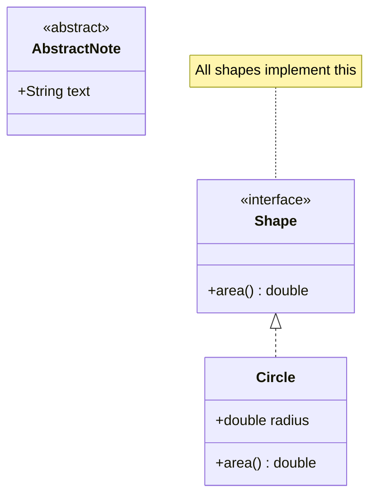

## Sequence Diagram

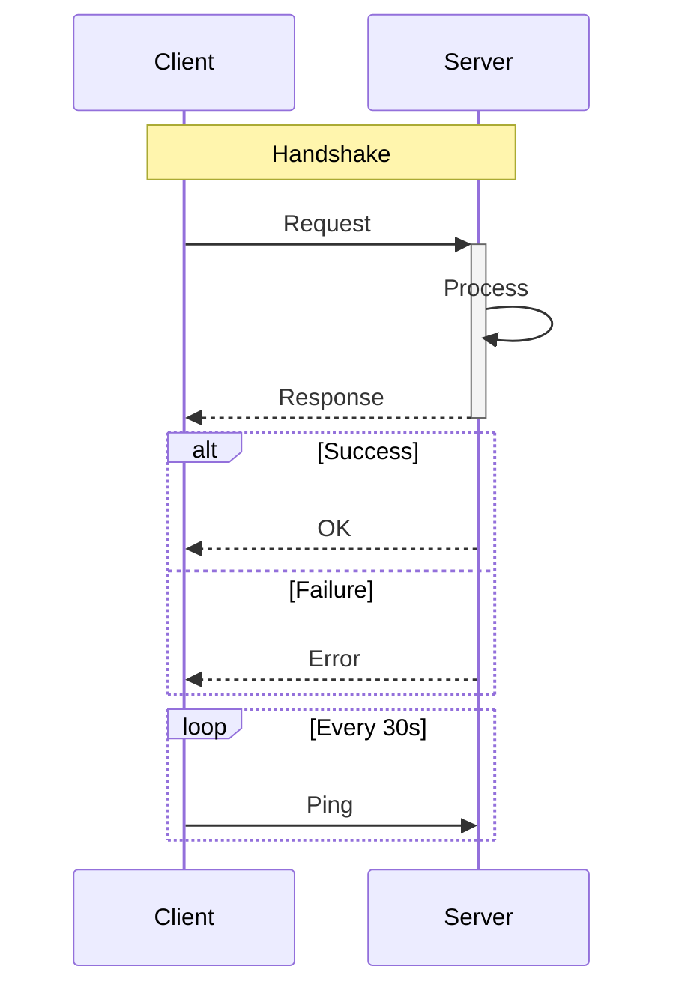

## State Diagram

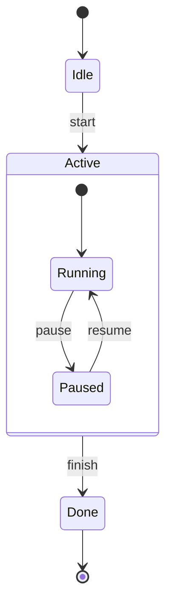

## ER Diagram

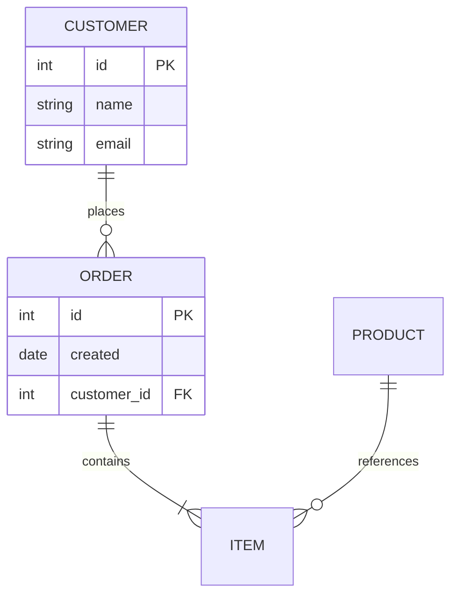

## Flowchart

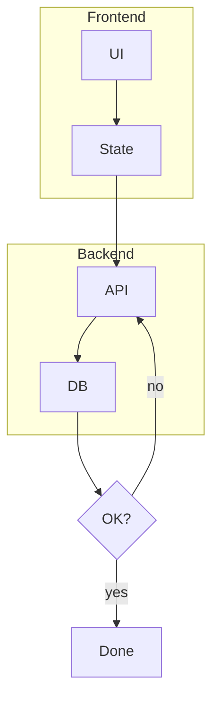

## Pie Chart

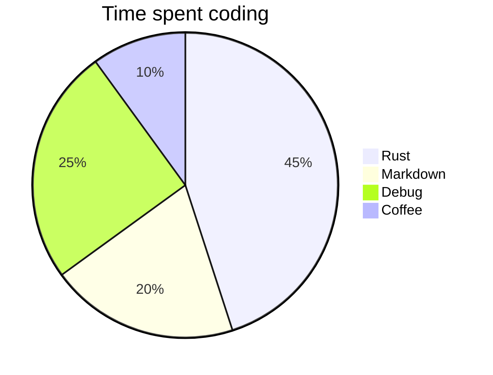

## Gantt

```mermaid
gantt
  title Sprint 12
  section Design
    Wireframes :done, 5d
    Mockups :active, 4d
  section Dev
    Backend :crit, 10d
    Frontend :8d
    Ship :milestone, 0d
```

## Mindmap

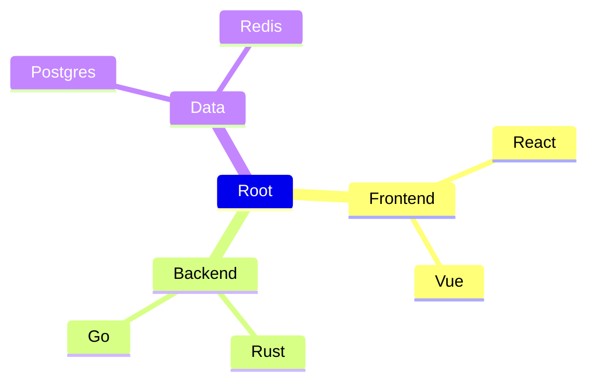

## Timeline

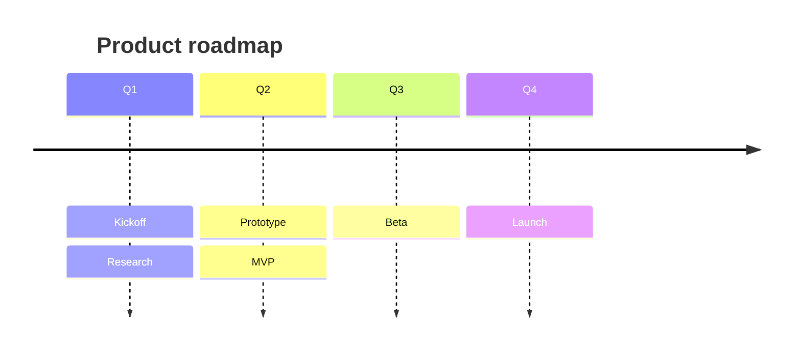

## Journey

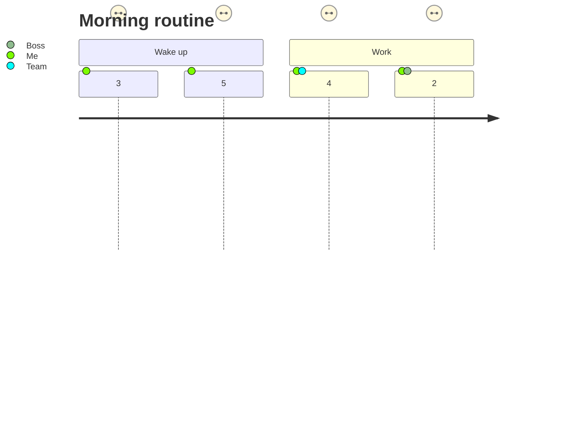

## Quadrant Chart

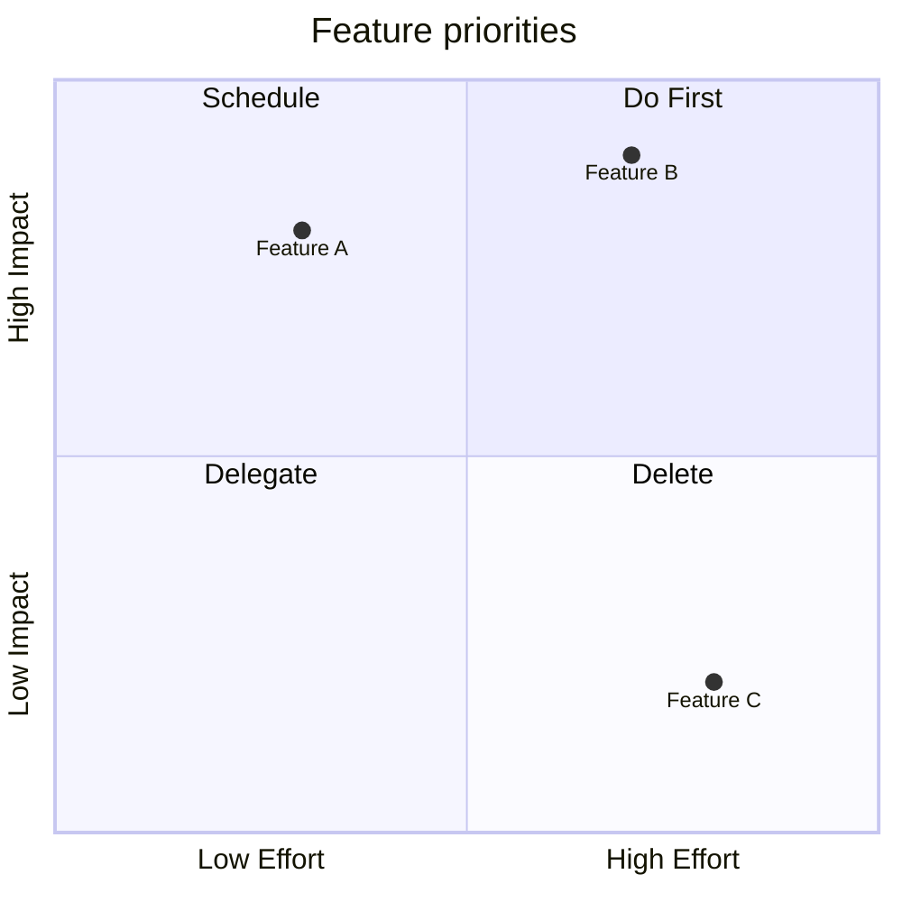

## Git Graph

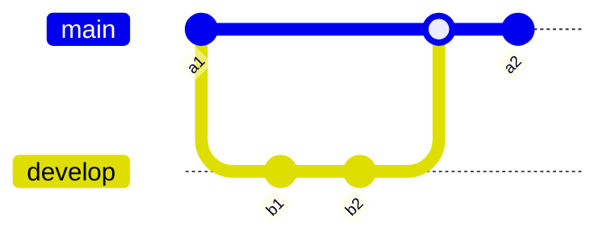

## Sankey

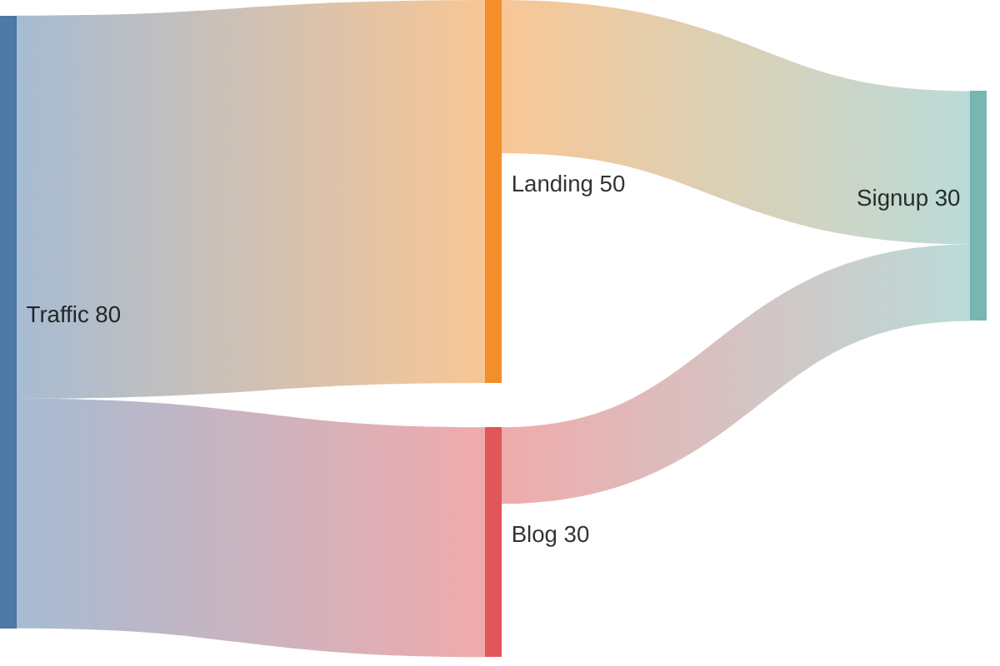

## Requirement Diagram

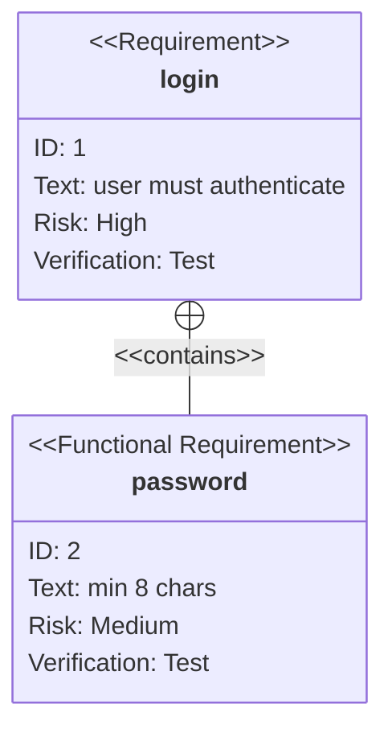

## C4 Context

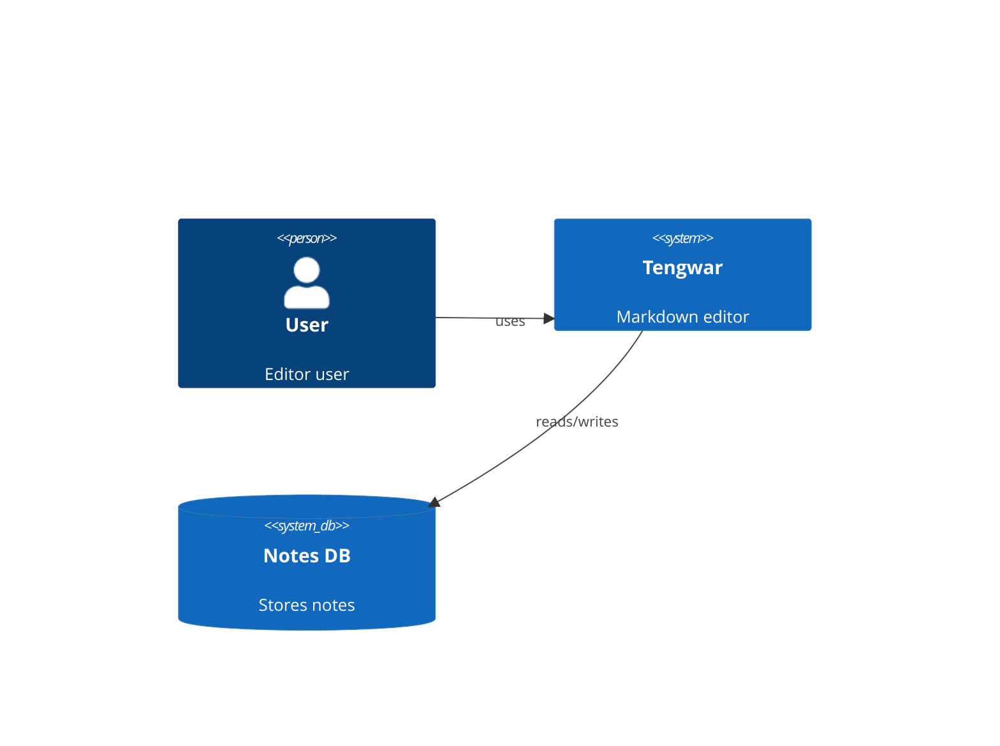

## XY Chart

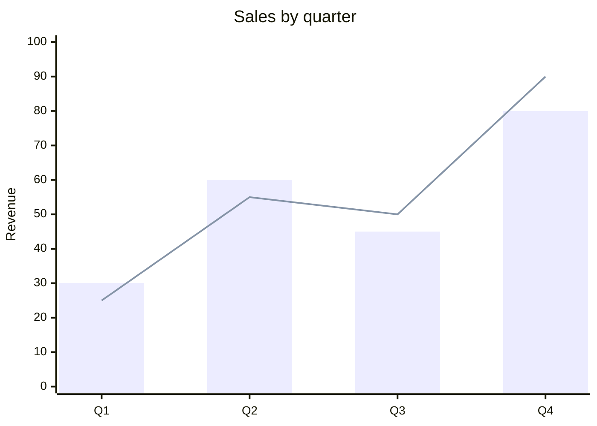

## Kanban

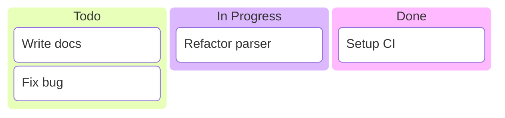

## Block Diagram

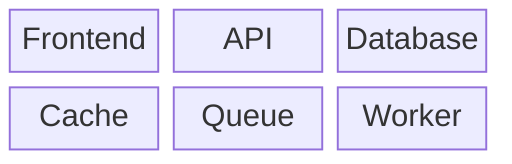

## Packet Diagram

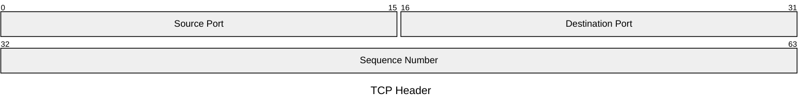

---

## Tips

- **Diagram download** — hover over any diagram to reveal **SVG** / **PNG** buttons
- **Zoom** — use **− 100% + Fit** in the toolbar
- **Vim commands** — press `:` in normal mode: `:w`, `:e file.md`, `:s/old/new/g`, `:42`
- **Git** — set a token with the 🔑 button to enable push/pull